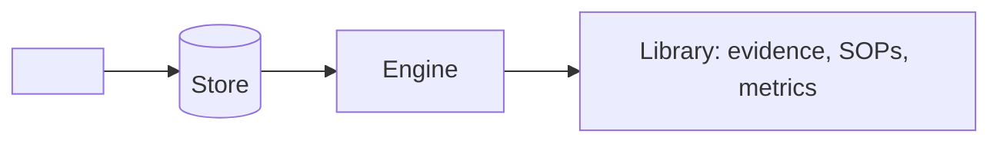

---
ai_ops:
  id: data-capture:company
  type: data-capture
---

# Data Capture — <Company Name>

**Status:** <planned | building | running | paused | retired>
**Access given by:** <The client person who gave each login or key, and when>
**Run by:** <Person at 3rd Brain>
**Last updated:** YYYY-MM-DD

<!--
How this client's process data is captured: each system a mapped workflow touches,
how its history is read, and where it goes. It is the build spec and the runbook for
the client's capture pipeline, built for this client and run where it fits; it is not a
client Project or Technical Scope. Each capture's settings live in
connections/<capture>.yaml; logins stay where the pipeline runs, never here.

For each system, take the first option that exists:
1. Log export
2. Activity log, read through the API or from the screen
3. Daily snapshots through the API
4. Daily snapshots from the screen
5. Webhooks or connected monitoring
6. Not possible (interviews, timing one case, a recording)
Past history (1 and 2) and history from today (3 to 5) are separate questions; a
system often needs one of each.

Link workflows, roles, and tools; do not restate their steps. Navigator draws each
workflow from its SOP.
-->

## Architecture

## Coverage

### <Workflow name, linked>

| Step | Role | Recorded in |
|---|---|---|
| <SOP step, as the SOP names it> | <role link> | <System and option; reported only; or not recorded> |

## Systems

### <System, tool link>

- **Follows:** <Workflow link and its primary record>
- **Option:** <The option chosen>, because <why the options above it are not available>
- **Covers:** <The past, from today, or both>
- **Pipeline:** <What it is and where it runs: a flow in the client's automation platform, a script adapted from an example pipeline in the consultant's harness, a scheduled agent, or an export>, its pipeline on the company's page in the FDE App web app, and [connections/<capture>.yaml](connections/<capture>.yaml)
- **Schedule:** <How often it runs, or once>
- **Connections:** <Each login, and the pipeline's delivery key: what it may read or deliver, who created it, who renews it, and where it is kept (the client's platform or the consultant's environment); never the value>
- **Data kept:** <The fields kept: record IDs, statuses, and times>
- **Tests:** <The sample check run before it was switched on, and its result>
- **Breaks when:** <What stops it, who fixes it, and how to switch it off>

## Owners

| Duty | Person |
|---|---|
| Runs the pipeline | <Person> |
| Renews sign-ins | <Person> |
| Told when a run fails | <Person> |
| Can stop it at the client | <Person> |

## Retention

<What is stored and where. Captured data is kept until the client asks for it to be deleted, or until a set time after the engagement ends.>

## Build log

| Date | Who | What | Time taken |
|---|---|---|---|
| YYYY-MM-DD | <Person> | <What was assembled or changed> | <Hours> |
