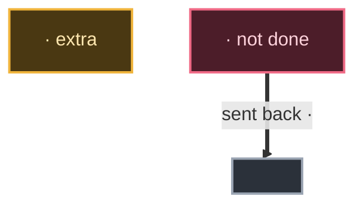

---
ai_ops:
  id: workflow:<workflow-slug>
  type: workflow
workflow:
  primary_record: record:<record-slug>
  accountable_owner: role:<role-slug> | unresolved
  depends_on:
    records: []
    workflows: []
    decisions: []
---

# <Workflow Name>

<!--
One workflow owns one business outcome for one primary record. Responsibility
defines the boundary; the record model tests it. Records have no standalone
files: reference the owning tool or data-architecture.md, never records/<slug>.md.
-->

**Primary record:** <record-slug> (<kind derived from data-architecture.md>)
**Accountable owner:** → [<role-slug>.md](../roles/<role-slug>.md)
<!-- If ownership is an explicit gap, replace the entire value above with: **Accountable owner:** Unresolved -->
**Last updated:** YYYY-MM-DD

## Jobs-to-be-done

When <trigger/situation>, <role> wants to <business outcome>, so <result>.

## SOP

- [ ] **<Action verb>** — <role> uses <tool/system> on <record> — <output or state change>
  - Why: <why the step exists, as people gave it, cited> | No one could say (<who was asked>)
  - Decides: <role>, only when someone other than the role doing the step decides
  - Takes: <work time for one case> (<reported: n cases | logged | estimated: low, likely, high | stated by <person>, cited>; <business hours | calendar>)
  - Waits before: <time since the step before ended> (<source, as for Takes>); waiting on: <a role, a team, the customer, a vendor, a system>; why: <batched | busy | other work first | someone unavailable | an outside party | not known>
  - Exception: <material edge case> — how often: <count in a window, such as "about 5 a week"> (reported by <person>, cited | reported: <n of N cases, window, from the client's export>); pulls in: <role>; one takes: <time>; a mistake costs: <what>; <where the answer lives>
  - Escalate: <when and to whom>
- [ ] **<Action verb>** — <role> uses <tool/system> on <record> — <output or state change>
- [ ] **<Action verb>** — …

<!-- Why, Decides, Takes, Waits before, and an exception's numbers come from interviews
and data; leave out what nobody has said. Takes is working time; Waits before is the time
the case sits between the step before and this one (a handoff, a queue, a customer or a
vendor), with what it waits on and why: work done in batches, a busy person, other work
first, someone unavailable, or an outside party. Each number keeps who said it: when a second person agrees, add their
citation; when they disagree, keep both answers on the same line, each with who said it.
A measured rate goes beside the reported one; it does not replace it. -->

<!-- The SOP checklist above is the single source of truth for the flow.
Do NOT author ASCII or mermaid flowcharts here — the Navigator renders the
right-angle flowchart directly from these steps. -->

<!--
Add Documented vs actual when the client has a documented version of this workflow:
an SOP, policy, or training document, or, with none, the sponsor's or department
head's description, cited. prompts/workflow-sop.md writes it once the SOP above rests
on at least two independent sources. Navigator shows it as the Documented vs actual
tab. The SOP above stays the record of how work runs today; never change it to match
the document.

## Documented vs actual

**Source:** <Document link, its owner, date, and who approved it | As described by <person>, cited>
**Confirmed:** <The workflow owner's words accepting the labels, with their location | not yet: proposal>
**Documented steps:** <Step>, <Step> (optional), <Step>, <End step> | <End step>

Use this SOP's step names.
Draw the documented path with the real process over it, with exactly these classes and
ordinary arrows between steps. A highlighted step carries its word tag; a loop is a
thick arrow (==>) labeled with its rate.

| Difference | How often | What it costs | Label | Evidence |
|---|---|---|---|---|
| <Extra step; skipped step; out of order: B before A; loop back to A> | <reported: n of N cases, window, from the client's export | estimated: a range someone gave | unknown> | <Time per case, from the evidence, when known> | <outdated document | work-around | local variation | unresolved> | <Citations> |
-->

## Automation / Agent Potential

**Target KOODAR level:** <K | KA | KDA | KDAR | KODAR | KOODAR | Unresolved>
**Lives in:** <current AI/automation system>
**Approach:** <existing integration | skill/configuration | custom workflow | other>

<Within-workflow automation only: what changes, why it fits, human decision points, and now/next/later scope.>

<!--
The Step sort gives every step, exception path, and handoff above one outcome,
tested in this order: remove, code (no AI), decision model (a decision table or a
scoring or classification model; no language model), LLM (one call or a fixed
chain), agent (a model in a harness that picks its own steps and uses tools), or
person. A step can be split, with each part's share of cases. A split step counts
once under each of its parts.
-->

**Step sort:** Remove <n> · Code <n> · Decision model <n> · LLM <n> · Agent <n> · Person <n>

| Step | Outcome | Test that decided it | Evidence | Oversight or hand-over | KOODAR |
|---|---|---|---|---|---|
| <SOP step, exception path, or handoff> | <remove | code | decision model | LLM | agent | person | split: code n%, LLM n%, person n%> | <Why the outcomes before it fail and this one passes; for a decision model, LLM, or agent: the risk, and the bar met (past decisions or test cases), or what is missing> | <Citations; shares measured by the data reader, or estimated with their source> | <acts alone | acts and tells <role> | asks <role> for approval; for a person: why it stays and what is handed to them> | <For an LLM or agent step: the capabilities it needs> |

**Constraints:**
- Prior attempts: <what was tried, what broke, and why>
- Integration walls: <API, access, vendor, or environment limits>
